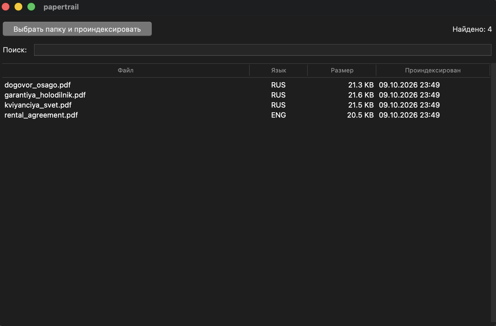

# papertrail

> Local document organizer with OCR search. Your papers never leave your computer.

Your receipts, contracts, warranties, and medical records are scattered across folders named "Downloads" and "Desktop". **papertrail** turns that chaos into a searchable, private archive — like Google Photos, but for your papers.

## Download

**macOS:** [⬇️ Download papertrail-0.1.0.dmg](https://github.com/trusdd/papertrail/releases/latest) (14 MB)

**Windows / Linux:** Not yet available. [Watch the repo](https://github.com/trusdd/papertrail) for updates.

## ⚠️ Requirements (read before first launch)

papertrail is an early MVP. Two manual steps are required before the app will work.

### 1. Install Tesseract and Poppler via Homebrew

    brew install tesseract tesseract-lang poppler

If you don't have Homebrew, install it first from [brew.sh](https://brew.sh) — it's a one-line command.

Tesseract is the OCR engine that reads text from your PDFs and scans. Poppler converts PDF pages into images. Both are external tools that papertrail calls from inside; they are not bundled yet.

### 2. Bypass macOS Gatekeeper

The app is not signed with an Apple Developer certificate yet, so macOS will block it on first launch. There are two ways around this:

**Option A (via Finder):**

1. Drag `papertrail.app` into Applications.
2. Right-click it in Applications → **Open** → in the dialog click **Open Anyway**.
3. From then on, double-click works normally.

**Option B (via Terminal):**

    xattr -cr /Applications/papertrail.app

After that, `papertrail` opens like any other app.

> Both steps will be automated in **v0.2.0** — Tesseract and Poppler will be bundled inside the `.app`, and the app will be signed.

## Why

There are two kinds of tools for managing documents today:

1. **Cloud services** like Google Drive and Dropbox — convenient, but you're giving a company permanent access to your passport scans and tax returns.
2. **Self-hosted solutions** like Paperless-ngx — powerful and private, but they require Docker, a server running 24/7, and comfort with the command line.

**papertrail is the missing middle.** It runs as a regular desktop app on your laptop, stores its index in a single SQLite file next to your documents, and never sends a single byte over the network.

## Features

- **Full-text search** inside PDFs and images (OCR via Tesseract)
- **100% local** — no cloud, no accounts, no telemetry
- **Russian + English** OCR out of the box
- **Portable archive** — copy the folder with documents, keep the index
- **Incremental indexing** — files are re-scanned only when they change (SHA-256)
- **Simple GUI** — pick a folder, search, double-click to open
- **Tested** — 39 unit tests, no GUI dependencies in the core

## Usage

1. Launch `papertrail`.
2. Click **"Выбрать папку и проиндексировать"** and pick a folder with your documents.
3. Wait while papertrail runs OCR on each file. The status bar shows progress.
4. Type anything in the **search box** — results update live as you type.
5. **Double-click** any row to open the file in your default app.

The index is stored in `~/papertrail.db`. Your documents stay where they are — papertrail never moves or modifies them.

## Install from source

### macOS

    brew install tesseract tesseract-lang poppler python-tk@3.12
    git clone https://github.com/trusdd/papertrail.git
    cd papertrail
    python3 -m venv .venv
    source .venv/bin/activate
    pip install -e .

### Linux

    sudo apt install tesseract-ocr tesseract-ocr-rus poppler-utils python3-tk
    git clone https://github.com/trusdd/papertrail.git
    cd papertrail
    python3 -m venv .venv
    source .venv/bin/activate
    pip install -e .

Then run:

    papertrail

## How it works

    papertrail/
    ├── src/papertrail/
    │   ├── db.py         # SQLite schema and queries
    │   ├── scanner.py    # folder walker + SHA-256 change detection
    │   ├── ocr.py        # Tesseract wrapper (PDF and images)
    │   ├── indexer.py    # glue: scan → OCR → upsert
    │   └── app.py        # Tkinter GUI
    └── tests/            # 39 tests, all mocked (no real Tesseract needed)

**Design principles:**

- **No cloud, ever.** The app has no networking code.
- **The index is yours.** A single SQLite file you can back up or move.
- **Incremental by default.** Files are hashed and re-indexed only when changed.
- **OCR is replaceable.** The `ocr.py` module is a thin wrapper — swap Tesseract for something else later.

## Roadmap

- [x] SQLite index and document model
- [x] Folder scanner with hash-based change detection
- [x] OCR via Tesseract (Russian + English)
- [x] Tkinter GUI with live search
- [x] Human-readable date formatting
- [x] Packaged `.dmg` for macOS
- [ ] Bundle Tesseract and Poppler inside the `.app`
- [ ] Sign and notarize the app with Apple Developer certificate
- [ ] Drag-and-drop a folder onto the window
- [ ] Auto-categorization (invoice, contract, receipt) by keywords
- [ ] Thumbnail previews instead of plain table
- [ ] Windows and Linux builds
- [ ] Multi-language OCR (German, French, Spanish)
- [ ] Encrypted index (optional password)

## Contributing

Issues and pull requests are welcome. If you're planning a big change, please open an issue first to discuss.

    pytest -v
    papertrail

## License

MIT — see [LICENSE](LICENSE).
